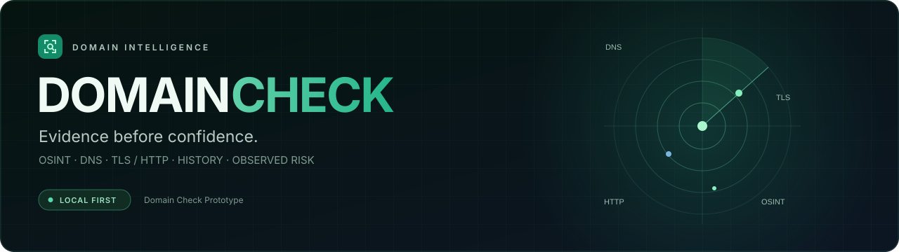
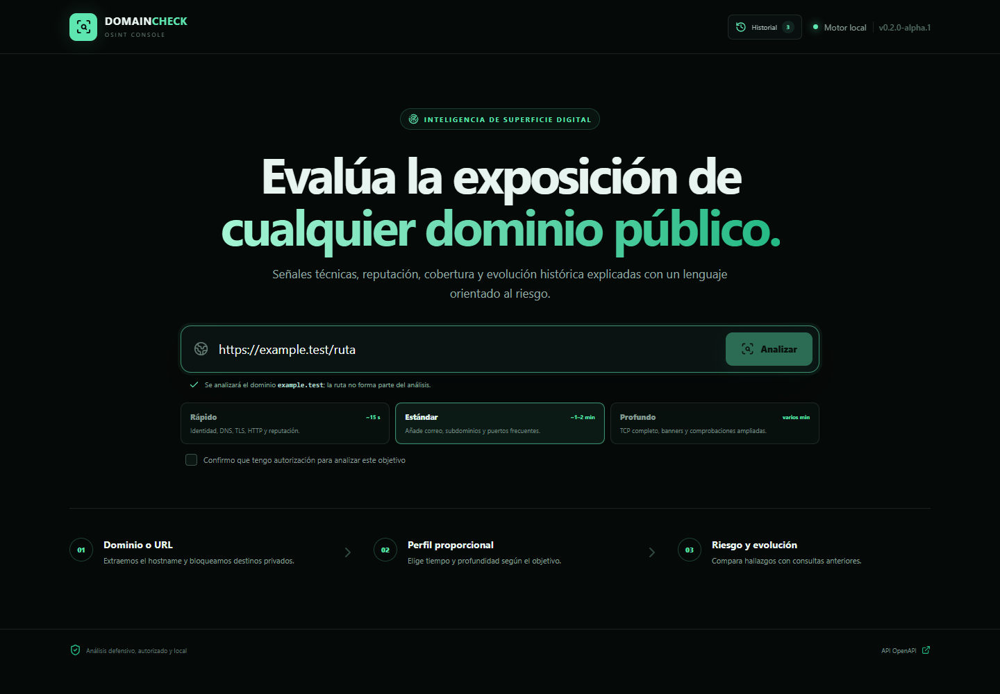
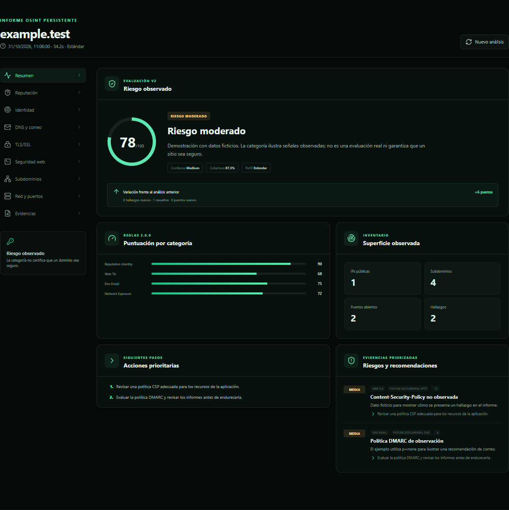
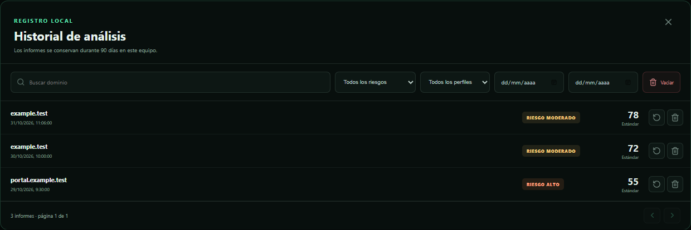

<div align="center">



# Domain Check Prototype

**Understand a domain's exposure. Keep the evidence. Track how it changes.**

React 19 · TypeScript · FastAPI · SQLite · Local first

[](https://github.com/zaper3/Prototipo-de-chequeo-dominios/actions/workflows/ci.yml)

[**Get started**](#get-started) · [Screenshots](#at-a-glance-three-stages-of-an-analysis) · [Documentation](#documentation) · [Español](README.md)

</div>

---

**0.2.0-alpha.1 — a local prototype under evaluation, not a stable release.** A dashboard that brings together public identity, DNS, TLS, HTTP, subdomain, network and optional reputation signals. It accepts domains or HTTP/HTTPS URLs, preserves the original input and analyzes only the normalized hostname.

Full reports are kept on this computer for 90 days, with history, comparisons and traceable findings. The category describes **observed risk**; it does not prove that a website is safe.

> **Defensive, authorized use only.** Every profile generates traffic to the target, including Quick (TLS and HTTP). Use it only on assets you own or are explicitly authorized to assess. The application has no authentication and must not be exposed to the Internet. [Security and boundaries](SECURITY.md).

## At a glance: three stages of an analysis

### Before: choose the target and scope

Enter a domain or paste a URL. The interface previews the hostname to be analyzed, excludes the path and lets you select a profile before confirming authorization.



*Screenshot of the running interface with a mocked API, captured on 2026-10-31. `example.test` is fictional: no scan was performed.*

### After: understand risk and what to review first

The overview separates category, score, confidence and coverage. It shows category scores, observed surface, priority actions and changes since the previous report.



*Real application UI with synthetic data. The 78/100 score and findings are illustrative; they do not describe an assessed domain or validate the risk engine.*

### Over time: return to previous reports

Search by domain, filter by risk, profile or dates and reopen a report without contacting the target again. You can also repeat it or delete it after confirmation.



*All three records are fictional. Private history was not accessed. [Screenshot provenance and reproduction](docs/media/README.md). The current application interface is in Spanish.*

## What you can do

| Feature | Behavior and scope |
|---|---|
| **Check identity** | WHOIS, registrar and available dates; age/expiry when the source provides them. RDAP is not implemented. |
| **Review DNS and email** | A/AAAA, MX, NS, TXT, CAA and other responses; SPF, DMARC, MTA-STS, TLS-RPT and basic DNSSEC presence signals according to profile. |
| **Inspect TLS and web settings** | Certificate, negotiated protocol/cipher, HTTP headers, observed redirects, cookies/CORS and limited initial content according to profile. Redirects are not followed. |
| **Discover subdomains** | Certificate Transparency; Deep adds common-name DNS lookups and dangling-CNAME indicators, without confirming a takeover. |
| **Observe network exposure** | Resolved IPs and TCP ports on the primary validated IP; bounded range in Standard and full range in Deep, subject to time limits and firewalls. |
| **Add external context** | Optional Google Safe Browsing, VirusTotal, SecurityTrails and MDN Observatory; availability is not certification. |
| **Understand findings** | Stable ID, severity, category, evidence, source, score impact, recommendation and a technical reference when available. |
| **Track changes** | SQLite history, filters/pagination, reopening, rerunning, comparisons and individual or bulk deletion with confirmation. |

Results are organized into **Overview, Reputation, Identity, DNS and email, TLS/SSL, Web security, Subdomains, Network and ports, and Evidence** (Spanish labels in the current UI).

## Get started

Requires **Python 3.12+, Node.js 24+ and npm 11+**. Local environment verified on 2026-10-31: Python 3.13.15, Node.js 24.14.0 and npm 11.9.0. The following commands target PowerShell.

1. **Prepare the checkout and configuration.** For an existing checkout, skip `git clone` and start at its root.

   ```powershell
   git clone https://github.com/zaper3/Prototipo-de-chequeo-dominios.git
   Set-Location Prototipo-de-chequeo-dominios
   if (-not (Test-Path .env)) { Copy-Item .env.example .env }
   ```

2. **Install and start the API.** Run the backend and Alembic from `backend/`: the default SQLite path depends on this working directory.

   ```powershell
   Set-Location backend
   python -m venv .venv
   .\.venv\Scripts\python.exe -m pip install -r requirements-dev.txt
   .\.venv\Scripts\python.exe -m alembic upgrade head
   .\.venv\Scripts\python.exe -m uvicorn app.main:app --reload --host 127.0.0.1 --port 8000
   ```

   Alternatively, activate the .venv with `.\.venv\Scripts\Activate.ps1` and use `python -m …`; do not copy virtual environments between locations.

3. **Open a second terminal at the checkout root and start the frontend.**

   ```powershell
   Set-Location frontend
   npm ci
   npm run dev -- --host 127.0.0.1
   ```

Open **http://127.0.0.1:5173**. Enter an authorized target, review its hostname and profile, confirm the scope and select **Analizar**. Deep requires a second confirmation.

| Local service | Address |
|---|---|
| Dashboard | `http://127.0.0.1:5173` |
| API health | `http://127.0.0.1:8000/api/v1/health` |
| Interactive OpenAPI | `http://127.0.0.1:8000/docs` |
| JSON contract | `http://127.0.0.1:8000/openapi.json` |

Vite proxies `/api` to `127.0.0.1:8000`. For clients calling the API directly, configure their origin in `FRONTEND_ORIGINS`.

## Profiles: depth proportional to the target

| Profile | Scope | Approximate duration |
|---|---|---|
| **Quick** | WHOIS/identity, primary DNS, TLS certificate, HTTP and configured reputation providers. No port scan. | ~15 s |
| **Standard — default** | Adds email/basic DNSSEC, CT, subdomains and TCP `1–1024` plus a curated list of sensitive services. | ~1–2 min |
| **Deep** | Adds TCP `1–65535`, safe banners, TLS protocol probes, subdomain DNS/CNAME, initial content and `security.txt`. | Several minutes |

Durations are estimates, not an SLA. The configurable time limit applies to the port loop, not the entire job. Deep does not enumerate every cipher or check HTTP/TLS availability for each subdomain.

**Out of scope:** searching for `.env`, `.git`, backups or admin panels; exploitation, authentication, injections, credentials, evasion, extensive crawling and UDP. Any future active web audit requires a separate OpenSpec change.

## Understanding the result

A higher score means fewer penalties under the available rules; it is not a probability of safety. Ruleset `2.0.0` retains `score` and `grade` for compatibility and adds risk, confidence, coverage and category scores.

| Category | Classification rule |
|---|---|
| **Insufficient data** | Coverage below 50%; takes precedence over score-based classification. |
| **Critical** | Score below 40 or a critical finding, including a threat identified by the rules. |
| **High** | Score 40–64 or a high-severity finding, unless a higher category applies. |
| **Moderate** | Score 65–84 or a medium finding, unless a higher category applies. |
| **Low** | Score 85–100 without findings that require escalation. |

Base weights are identity/reputation **35%**, web/TLS **25%**, DNS/email **20%** and network **20%**, normalized over available categories.

- **Confidence:** High, Medium or Low according to coverage and external intelligence availability.
- **Coverage:** completed modules versus those expected for the profile, not the percentage of ports or exhaustiveness.
- **Actions:** up to three available priorities and contextual findings to review.
- **Comparison:** score delta, new/resolved findings and certificate, port and subdomain changes versus the domain's previous report.

A missing provider does not directly subtract reputation points, but may reduce coverage/confidence. Other fallbacks have unresolved scoring limitations: see the [risk register](docs/registers/KNOWN_RISKS.md).

## Data and configuration

Full reports are stored in **`data/domaincheck.db`**, excluded from Git, using async SQLAlchemy, Alembic and SQLite WAL. Default retention is **90 days**.

At startup, `queued/running` jobs become `interrupted` rather than resuming; expired rows are purged. Cleanup also runs after completed analyses. Tasks are not a durable queue.

| Variable | Default / purpose |
|---|---|
| `APP_ENV` | `development` |
| `FRONTEND_ORIGINS` | `http://localhost:5173`; CORS origins for direct clients |
| `DATABASE_URL` | `sqlite+aiosqlite:///../data/domaincheck.db`, relative to `backend/` |
| `HISTORY_RETENTION_DAYS` | `90` |
| `SCAN_MAX_SECONDS` | `180`; port-loop deadline, not a global timeout |
| `PORT_SCAN_TIMEOUT_SECONDS` / `PORT_SCAN_CONCURRENCY` | `0.25` / `200` |
| `RATE_LIMIT_SCANS` / `RATE_LIMIT_WINDOW_SECONDS` | `5` / `300` seconds |
| `SUBDOMAIN_RESULT_LIMIT` | `100` |
| `VIRUSTOTAL_API_KEY` / `SECURITYTRAILS_API_KEY` / `GOOGLE_SAFE_BROWSING_API_KEY` | Optional; empty by default |
| `MDN_OBSERVATORY_ENABLED` | `false`; optional enrichment |

See [.env.example](.env.example). [Safe Browsing](https://developers.google.com/safe-browsing/) is restricted to personal/non-commercial use allowed by its API; review each provider's terms and quotas before enabling it.

SQLite and backups are **not encrypted**. Original URLs, WHOIS, cookies, headers and errors may contain sensitive data or keys: review them before sharing. Automatic secret redaction is not guaranteed.

To create a consistent backup, from the root:

```powershell
.\backend\.venv\Scripts\python.exe scripts/backup-history.py data/domaincheck.db data/backup-manual.db
```

The destination must be new. Copying only `.db` while WAL is active may omit transactions. [Backup, restore and operations](docs/OPERATIONS.md).

## Security and known limitations

- **Local, single-operator application**, without authentication or public deployment; the GitHub repository itself is public.
- Rejects direct IPs, credentials, explicit ports and initially non-global DNS resolutions. This reduces SSRF but **does not eliminate DNS rebinding in HTTP**.
- Rate limiting and TCP limits exist; there is no global concurrent-job limit or guaranteed total timeout.
- WHOIS may be hidden; CT includes historical names; a CDN or firewall limits what a single-IP check can observe.
- DNSSEC only detects DS/DNSKEY; MTA-STS/TLS-RPT only query TXT. It does not validate the DNSSEC chain or fetch MTA-STS policies.
- Scoring, privacy and dependency risks remain open. Dependency alerts recorded on 2026-10-11 are a snapshot of that date, not a current dependency audit.
- The analysis is not a substitute for a professional audit and does not certify a site, even with a high score.

[Security policy](SECURITY.md) · [Known risks](docs/registers/KNOWN_RISKS.md) · [Bugs](docs/registers/BUGS.md) · [Fixes](docs/registers/FIXES.md)

## Documentation

| Document | Purpose |
|---|---|
| [Architecture](docs/ARCHITECTURE.md) | Flow, modules, persistence and technical decisions. |
| [Operations, DevOps and ITIL](docs/OPERATIONS.md) | Running, backup, restore and incident/change management. |
| [Versions and candidates](docs/RELEASE_MANAGEMENT.md) | SemVer, gates, immutable tags and publication. |
| [Candidate register](docs/registers/RELEASE_CANDIDATES.md) | Historical evidence and release status. |
| [Changelog](CHANGELOG.md) | Evolution and changes not yet published as a release. |
| [OpenSpec 0.2.0 change](openspec/changes/add-history-and-risk-engine/) | History, profiles and risk engine. |
| [Screenshots and provenance](docs/media/README.md) | Synthetic data, reproduction and visual-review boundaries. |
| [README validation](docs/validation/2026-10-31-readme-refresh.md) | Preserved information and scope of local checks. |
| [Reusable README guide](docs/README_STYLE_GUIDE.md) | ES/EN structure and rules for future projects. |
| [Contributing](CONTRIBUTING.md) | Branches, tests and documentation traceability. |
| [Workspace consolidation audit](docs/WORKSPACE_AUDIT_2026-10-11.md) | Copy comparison and historical migration evidence. |

Linked technical documents are mostly in Spanish. [README principal en español](README.md) maintains the same capabilities, instructions and warnings.

## Development and verification

Stack: **React 19, TypeScript, Vite 8, FastAPI, async SQLAlchemy, Alembic and SQLite**. Method: **OpenSpec**, DevOps CI and adapted ITIL change, incident, fix and release registers.

From the root, with dependencies installed:

```powershell
Push-Location backend
.\.venv\Scripts\python.exe -m ruff check app tests migrations
.\.venv\Scripts\python.exe -m ruff format --check app tests migrations
.\.venv\Scripts\python.exe -m pytest
Pop-Location

Push-Location frontend
npm test
npm run build
Pop-Location

.\backend\.venv\Scripts\python.exe -m unittest discover -s scripts/tests
.\backend\.venv\Scripts\python.exe -m ruff check scripts
.\backend\.venv\Scripts\python.exe -m ruff format --check scripts
node scripts/check-docs.mjs
node scripts/docs/check-readme.mjs
node --test scripts/docs/source-digest.test.mjs
npx -y @fission-ai/openspec@1.14.1 validate --all --no-interactive
```

Also validate `python -m alembic upgrade head` from `backend/` against a new disposable database using `DATABASE_URL`. Automated tests mock external sources: they do not scan public domains. Green CI does not prove the absence of vulnerabilities or replace authorized real-world checks or full accessibility testing.

The product remains **`0.2.0-alpha.1`**, following [SemVer 2.0.0](https://semver.org/). This is a documentation update under `Unreleased`: it neither creates a release nor moves the published tag.

### Workspace on this computer

The canonical path since 2026-10-11 is:

`C:\Users\Usuario\Documents\Visual Studio Projects\Prototipo de chequeo dominios`

Open [DomainCheck.code-workspace](DomainCheck.code-workspace) there. Previous locations are retired from development; their cleanup is managed by the owner. On other computers, choose your own checkout and recreate the .venv after changing paths.

---

Personal project by **zaper3**. This version does not include a `LICENSE` file; this documentation update does not introduce or change a license.
