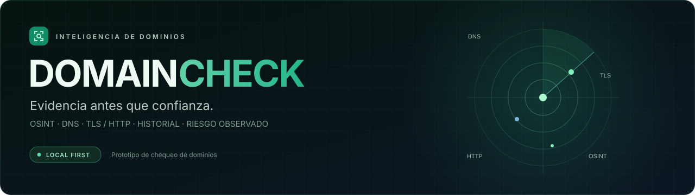

<div align="center">



# Prototipo de chequeo de dominios

**Entiende la exposición de un dominio. Conserva la evidencia. Sigue su evolución.**

React 19 · TypeScript · FastAPI · SQLite · Local primero

[](https://github.com/zaper3/Prototipo-de-chequeo-dominios/actions/workflows/ci.yml)

[**Empezar**](#empezar) · [Capturas](#un-vistazo-tres-momentos-del-análisis) · [Documentación](#documentación) · [English](README.en.md)

</div>

---

**0.2.0-alpha.1 — prototipo local en evaluación, no una release estable.** Un dashboard para reunir señales públicas de identidad, DNS, TLS, HTTP, subdominios, red y reputación opcional. Acepta dominios o URLs HTTP/HTTPS, conserva la entrada original y analiza exclusivamente el hostname normalizado.

Los informes se guardan en este equipo durante 90 días, con historial, comparación y hallazgos trazables. La categoría comunica **riesgo observado**, no demuestra que una web sea segura.

> **Solo uso defensivo y autorizado.** Todos los perfiles generan tráfico hacia el objetivo, incluido rápido (TLS y HTTP). Úsalo sobre activos propios o con autorización expresa. La aplicación no tiene autenticación y no debe exponerse a Internet. [Seguridad y límites](SECURITY.md).

## Un vistazo, tres momentos del análisis

### Antes: elegir objetivo y alcance

Introduce un dominio o pega una URL. La interfaz anticipa qué hostname analizará, excluye la ruta y permite elegir un perfil antes de confirmar autorización.


*Captura de la interfaz en ejecución con una API simulada, tomada el 2026-10-31. `example.test` es un ejemplo ficticio: no se realizó ningún escaneo.*

### Después: entender el riesgo y qué revisar primero

El resumen separa categoría, score, confianza y cobertura. Presenta subpuntuaciones, superficie observada, acciones prioritarias y cambios frente al informe anterior.


*Interfaz real con datos sintéticos. El 78/100 y los hallazgos son ilustrativos; no corresponden a un dominio evaluado ni acreditan la eficacia del motor.*

### Con el tiempo: volver a los informes

Busca por dominio, filtra por riesgo, perfil o fechas y reabre un informe sin volver a contactar al objetivo. También puedes repetirlo o eliminarlo con confirmación.


*Los tres registros son ficticios. No se leyó el historial privado. [Procedencia y reproducción de las capturas](docs/media/README.md). La interfaz actual está en español.*

## Qué puedes hacer

| Función | Comportamiento y alcance |
|---|---|
| **Consultar identidad** | WHOIS, registrador y fechas disponibles; antigüedad/caducidad cuando la fuente las aporta. RDAP no está implementado. |
| **Revisar DNS y correo** | A/AAAA, MX, NS, TXT, CAA y otras respuestas; señales de SPF, DMARC, MTA-STS, TLS-RPT y presencia básica de DNSSEC según perfil. |
| **Examinar TLS y web** | Certificado, protocolo/cipher negociado, cabeceras HTTP, redirects observados, cookies/CORS y contenido inicial limitado según perfil. No sigue redirects. |
| **Descubrir subdominios** | Certificate Transparency; profundo añade DNS de nombres comunes e indicios de CNAME colgante, sin confirmar un takeover. |
| **Observar exposición de red** | IPs resueltas y puertos TCP de la IP principal validada; alcance acotado en estándar y completo en profundo, sujeto a plazo y firewall. |
| **Añadir contexto externo** | Google Safe Browsing, VirusTotal, SecurityTrails y MDN Observatory opcionales; su disponibilidad no equivale a certificación. |
| **Entender los hallazgos** | ID estable, severidad, categoría, evidencia, fuente, impacto en score, recomendación y referencia técnica cuando está disponible. |
| **Seguir la evolución** | Historial SQLite, filtros/paginación, reapertura, repetición, comparación y borrado individual o total con confirmación. |

Los resultados se organizan en **Resumen, Reputación, Identidad, DNS y correo, TLS/SSL, Seguridad web, Subdominios, Red y puertos y Evidencias**.

## Empezar

Requiere **Python 3.12+, Node.js 24+ y npm 11+**. Entorno local verificado el 2026-10-31: Python 3.13.15, Node.js 24.14.0 y npm 11.9.0. Los siguientes comandos son para PowerShell.

1. **Prepara el checkout y la configuración.** En un checkout existente, omite `git clone` y sitúate en su raíz.

   ```powershell
   git clone https://github.com/zaper3/Prototipo-de-chequeo-dominios.git
   Set-Location Prototipo-de-chequeo-dominios
   if (-not (Test-Path .env)) { Copy-Item .env.example .env }
   ```

2. **Instala e inicia la API.** Ejecuta el backend y Alembic desde `backend/`: la ruta predeterminada de SQLite depende de ese directorio.

   ```powershell
   Set-Location backend
   python -m venv .venv
   .\.venv\Scripts\python.exe -m pip install -r requirements-dev.txt
   .\.venv\Scripts\python.exe -m alembic upgrade head
   .\.venv\Scripts\python.exe -m uvicorn app.main:app --reload --host 127.0.0.1 --port 8000
   ```

   Puedes activar la .venv con `.\.venv\Scripts\Activate.ps1` y usar `python -m …`; no copies un entorno virtual desde otra ubicación.

3. **Abre una segunda terminal en la raíz del checkout e inicia el frontend.**

   ```powershell
   Set-Location frontend
   npm ci
   npm run dev -- --host 127.0.0.1
   ```

Abre **http://127.0.0.1:5173**. Introduce un objetivo autorizado, revisa el hostname y el perfil, confirma el alcance y pulsa **Analizar**. Profundo requiere una segunda confirmación.

| Servicio local | Dirección |
|---|---|
| Dashboard | `http://127.0.0.1:5173` |
| API y salud | `http://127.0.0.1:8000/api/v1/health` |
| OpenAPI interactiva | `http://127.0.0.1:8000/docs` |
| Contrato JSON | `http://127.0.0.1:8000/openapi.json` |

Vite envía `/api` a `127.0.0.1:8000`. Para clientes que llamen directamente a la API, configura su origen en `FRONTEND_ORIGINS`.

## Perfiles: profundidad proporcional al objetivo

| Perfil | Alcance | Tiempo orientativo |
|---|---|---|
| **Rápido** | WHOIS/identidad, DNS principal, certificado TLS, HTTP y reputación configurada. Sin escaneo de puertos. | ~15 s |
| **Estándar — predeterminado** | Añade correo/DNSSEC básico, CT, subdominios y TCP `1–1024` más una lista curada de servicios sensibles. | ~1–2 min |
| **Profundo** | Añade TCP `1–65535`, banners seguros, prueba de protocolos TLS, DNS/CNAME de subdominios, contenido inicial y `security.txt`. | Varios minutos |

Las duraciones son estimaciones, no un SLA. El plazo configurable afecta al bucle de puertos, no al trabajo completo. Profundo no enumera todos los cifrados ni comprueba HTTP/TLS de cada subdominio.

**Fuera de alcance:** búsqueda de `.env`, `.git`, backups o paneles, explotación, autenticación, inyecciones, credenciales, evasión, crawling extensivo y UDP. Una futura auditoría web activa requiere otro cambio OpenSpec.

## Cómo interpretar el resultado

Un score mayor indica menor penalización en las reglas disponibles; no es una probabilidad de seguridad. El motor de reglas `2.0.0` mantiene `score` y `grade` por compatibilidad y añade riesgo, confianza, cobertura y subpuntuaciones.

| Categoría | Regla de clasificación |
|---|---|
| **Datos insuficientes** | Cobertura menor del 50 %; tiene prioridad sobre la clasificación por score. |
| **Crítico** | Score menor de 40 o hallazgo crítico, incluida una amenaza identificada por las reglas. |
| **Alto** | Score 40–64 o hallazgo de severidad alta, salvo categoría superior. |
| **Moderado** | Score 65–84 o hallazgo medio, salvo categoría superior. |
| **Bajo** | Score 85–100 sin hallazgos que obliguen a elevar la categoría. |

Los pesos base son identidad/reputación **35 %**, web/TLS **25 %**, DNS/correo **20 %** y red **20 %**, normalizados sobre categorías disponibles.

- **Confianza:** Alta, Media o Baja según cobertura y disponibilidad externa.
- **Cobertura:** módulos completados frente a los esperados del perfil; no mide porcentaje de puertos ni exhaustividad.
- **Acciones:** hasta tres prioridades disponibles y hallazgos con contexto para revisarlas.
- **Comparación:** diferencia de score, hallazgos nuevos/resueltos y cambios en certificado, puertos y subdominios frente al informe anterior del dominio.

La ausencia de un proveedor no aplica una penalización directa de reputación, pero puede reducir cobertura/confianza. Otros fallbacks tienen limitaciones de scoring pendientes: consulta el [registro de riesgos](docs/registers/KNOWN_RISKS.md).

## Datos y configuración

Los informes completos se guardan en **`data/domaincheck.db`**, fuera de Git, mediante SQLAlchemy asíncrono, Alembic y SQLite WAL. La retención predeterminada es de **90 días**.

Al arrancar, los trabajos `queued/running` se marcan `interrupted`, no se reanudan; se purgan filas vencidas. La limpieza también se ejecuta tras completar análisis. Las tareas no constituyen una cola duradera.

| Variable | Valor predeterminado / propósito |
|---|---|
| `APP_ENV` | `development` |
| `FRONTEND_ORIGINS` | `http://localhost:5173`; orígenes CORS de clientes directos |
| `DATABASE_URL` | `sqlite+aiosqlite:///../data/domaincheck.db`, relativa a `backend/` |
| `HISTORY_RETENTION_DAYS` | `90` |
| `SCAN_MAX_SECONDS` | `180`; plazo del bucle de puertos, no timeout global |
| `PORT_SCAN_TIMEOUT_SECONDS` / `PORT_SCAN_CONCURRENCY` | `0.25` / `200` |
| `RATE_LIMIT_SCANS` / `RATE_LIMIT_WINDOW_SECONDS` | `5` / `300` segundos |
| `SUBDOMAIN_RESULT_LIMIT` | `100` |
| `VIRUSTOTAL_API_KEY` / `SECURITYTRAILS_API_KEY` / `GOOGLE_SAFE_BROWSING_API_KEY` | Opcionales; vacías por defecto |
| `MDN_OBSERVATORY_ENABLED` | `false`; enriquecimiento opcional |

Consulta [.env.example](.env.example). [Safe Browsing](https://developers.google.com/safe-browsing/) se limita al uso personal/no comercial permitido por su API; revisa condiciones y cuotas de cada proveedor antes de habilitarlo.

SQLite y los respaldos **no están cifrados**. La URL original, WHOIS, cookies, cabeceras y errores pueden contener datos sensibles o claves: no los publiques sin revisar. No se garantiza redacción automática.

Para crear un respaldo consistente, desde la raíz:

```powershell
.\backend\.venv\Scripts\python.exe scripts/backup-history.py data/domaincheck.db data/backup-manual.db
```

El destino debe ser nuevo. Con WAL activo, copiar solo `.db` puede omitir transacciones. [Respaldo, restauración y operación](docs/OPERATIONS.md).

## Seguridad y límites conocidos

- Aplicación **local para un único operador**, sin autenticación ni despliegue público; el repositorio de GitHub sí es público.
- Rechaza IP directas, credenciales, puertos explícitos y resoluciones iniciales no globales. El bloqueo reduce SSRF, pero **no elimina DNS rebinding en HTTP**.
- Hay rate limit y límites TCP, no límite global de trabajos simultáneos ni timeout total garantizado.
- WHOIS puede estar oculto; CT incluye nombres históricos; una CDN o un firewall limitan lo observado en una sola IP.
- DNSSEC solo detecta DS/DNSKEY; MTA-STS/TLS-RPT solo TXT. No valida la cadena DNSSEC ni descarga la política MTA-STS.
- Riesgos de scoring, privacidad y dependencias permanecen abiertos. Las alertas registradas el 2026-10-11 son una fotografía de esa fecha, no una auditoría de dependencias actual.
- El análisis no sustituye una auditoría profesional ni certifica un sitio, incluso con score alto.

[Política de seguridad](SECURITY.md) · [Riesgos conocidos](docs/registers/KNOWN_RISKS.md) · [Bugs](docs/registers/BUGS.md) · [Fixes](docs/registers/FIXES.md)

## Documentación

| Documento | Para qué sirve |
|---|---|
| [Arquitectura](docs/ARCHITECTURE.md) | Flujo, módulos, persistencia y decisiones técnicas. |
| [Operación, DevOps e ITIL](docs/OPERATIONS.md) | Ejecutar, respaldar, restaurar y gestionar incidentes/cambios. |
| [Versiones y candidatas](docs/RELEASE_MANAGEMENT.md) | SemVer, gates, tags inmutables y publicación. |
| [Registro de candidatas](docs/registers/RELEASE_CANDIDATES.md) | Evidencia histórica y estado de releases. |
| [Changelog](CHANGELOG.md) | Evolución y cambios todavía no publicados como release. |
| [Cambio OpenSpec 0.2.0](openspec/changes/add-history-and-risk-engine/) | Historial, perfiles y motor de riesgo. |
| [Capturas y procedencia](docs/media/README.md) | Datos sintéticos, reproducción y límites de la revisión visual. |
| [Validación de este README](docs/validation/2026-10-31-readme-refresh.md) | Información preservada y alcance de las comprobaciones locales. |
| [Guía reutilizable de README](docs/README_STYLE_GUIDE.md) | Estructura ES/EN y reglas para futuros proyectos. |
| [Contribución](CONTRIBUTING.md) | Ramas, pruebas y trazabilidad documental. |
| [Auditoría de consolidación](docs/WORKSPACE_AUDIT_2026-10-11.md) | Comparación de copias y evidencia histórica del traslado. |

La documentación técnica enlazada está principalmente en español. [English README](README.en.md) mantiene las mismas capacidades, instrucciones y advertencias.

## Desarrollo y verificación

Stack: **React 19, TypeScript, Vite 8, FastAPI, SQLAlchemy asíncrono, Alembic y SQLite**. Método: **OpenSpec**, CI DevOps y registros adaptados de cambios, incidentes, fixes y releases ITIL.

Desde la raíz, con dependencias instaladas:

```powershell
Push-Location backend
.\.venv\Scripts\python.exe -m ruff check app tests migrations
.\.venv\Scripts\python.exe -m ruff format --check app tests migrations
.\.venv\Scripts\python.exe -m pytest
Pop-Location

Push-Location frontend
npm test
npm run build
Pop-Location

.\backend\.venv\Scripts\python.exe -m unittest discover -s scripts/tests
.\backend\.venv\Scripts\python.exe -m ruff check scripts
.\backend\.venv\Scripts\python.exe -m ruff format --check scripts
node scripts/check-docs.mjs
node scripts/docs/check-readme.mjs
node --test scripts/docs/source-digest.test.mjs
npx -y @fission-ai/openspec@1.14.1 validate --all --no-interactive
```

Valida también `python -m alembic upgrade head` desde `backend/`, sobre una base nueva desechable mediante `DATABASE_URL`. Las pruebas automatizadas mockean fuentes externas: no escanean dominios públicos. CI verde no demuestra ausencia de vulnerabilidades ni sustituye pruebas reales autorizadas o accesibilidad completa.

El producto sigue en **`0.2.0-alpha.1`**, bajo [SemVer 2.0.0](https://semver.org/). Esta actualización es documental, queda en `Unreleased` y no crea release ni mueve el tag publicado.

### Workspace de este equipo

La ruta canónica desde el 2026-10-11 es:

`C:\Users\Usuario\Documents\Visual Studio Projects\Prototipo de chequeo dominios`

Abre [DomainCheck.code-workspace](DomainCheck.code-workspace) allí. Las ubicaciones anteriores están retiradas del desarrollo; el propietario gestiona su limpieza. En otros equipos, elige tu propio checkout y recrea la .venv al cambiar de ruta.

---

Proyecto personal de **zaper3**. Esta versión no incluye un archivo `LICENSE`; esta actualización documental no introduce ni cambia una licencia.
